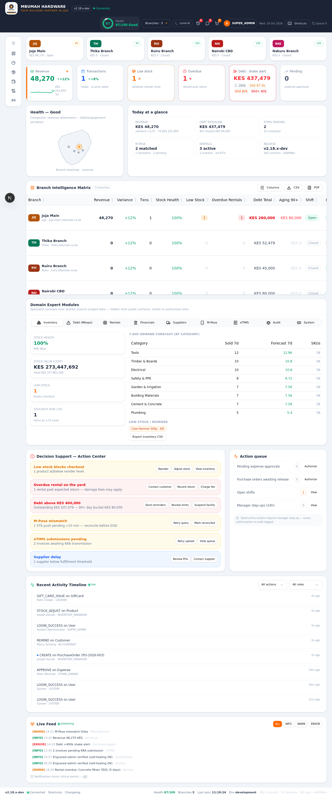
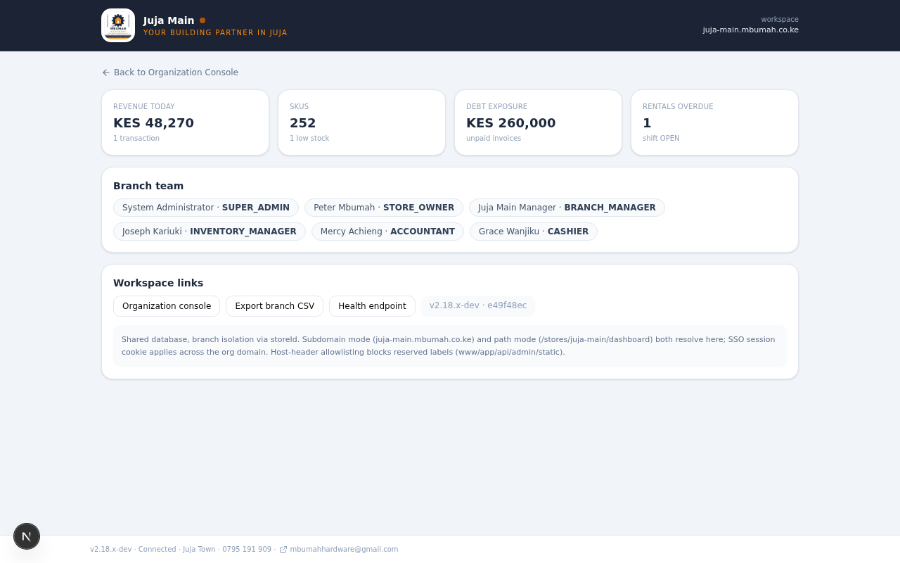
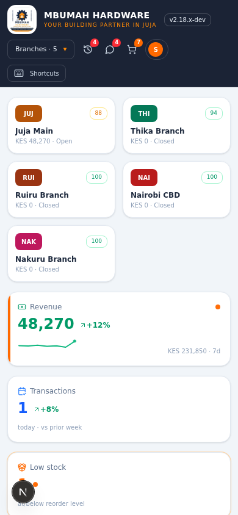

# Mbumah Hardware POS & ERP

**YOUR BUILDING PARTNER IN JUJA**



Production-grade Point of Sale + ERP for Mbumah Hardware (Juja, Kenya) — one shared database, five branch workspaces, a dark-glass **Organization Console (Expert Information System v3.0)**, and an offline-first POS core with Windows standalone packaging + auto-updater.

- **Current release:** `v2.18.2.1` (CORRECTION on the `v2.18.2` FEATURE line)
- **Stack:** Next.js 16 (App Router) · TypeScript · Tailwind CSS 4 · shadcn/ui · Prisma 6 + SQLite · NextAuth-style scrypt sessions
- **Domains:** org console `mbumah.co.ke` · demo `mbumahhardware.co.ke` · branch subdomains `{juja-main,thika,ruiru,nairobi-cbd,nakuru}.mbumah.co.ke`

---

## Brand

Official mark from the Mbumah Store Card: navy gear `#12243D` / `#0F1E33`, orange house `#FF8C00`, silver trowel, twin vertical rebar pillars, wordmark + tagline. Full rules (clear space, minimum sizes, do/don't): [`docs/BRAND.md`](docs/BRAND.md).

| Asset | Path |
|---|---|
| Vector master | `public/logo.svg` |
| Raster 512 | `public/logo.png` |
| Web-optimized | `public/logo.webp` |
| App icon / favicon | `src/app/icon.svg` · `src/app/favicon.ico` |

## Organization Console (`/`)

| Branch workspaces (`/stores/[storeCode]/dashboard`) |
|---|
|  |

The console is the single pane of glass over all five branches:

- **Header** — 48×48 logo tile, `v2.18.x-dev` identity, Connected pulse, **Health 87/100** gauge (animated 0→87), branch selector, ⌘K command palette, notifications, global chat, cart, SUPER_ADMIN chip, shortcuts (F2/F3/F4/F5/F11), offline/queue indicator.
- **KPI command row** — Revenue 48,270 (+12%, count-up, 7-day sparkline, 7d/30d/90d trend modal), Transactions 1 (+8%), Low stock 1 (orange pulse), Overdue 1 (red pulse), **Debt KES 437,479** (red shake >400k + aging chips), Pending 0.
- **Branch Intelligence Matrix** — 13 columns, sticky header, drag-resizable + hideable columns, CSV/PDF export, per-row Open-Workspace modal (POS / Inventory / Customers tabs), Start/Close Shift, View Reports.
- **9 Domain Expert Modules** — Inventory · Debt (Mkopo) · Rentals · Financials (double-entry, trial balance, VAT 16%) · Suppliers · M-Pesa (Daraja STK ledger) · eTIMS (KRA) · Audit (live) · System. Sensitive fields (cost prices, rent roll) are role-gated and stripped server-side.
- **Decision Support** — severity-ranked alerts with one-tap actions (reorder, reminders, reconcile, retry eTIMS upload…), action queue, manager step-up (audit-logged).
- **Recent Activity Timeline** — live pop-in (15s poll), branch/role/action filters, detail modal.
- **Global Chat** — org + per-branch scopes, 8s poll, rate-limited. **Live Feed** — system log stream with level filters.
- Every section is wrapped in a `SectionErrorBoundary` — one crashing panel never blanks the console.



## Multi-branch workspaces

- Path mode: `/stores/{code}/dashboard` (works everywhere) · Subdomain mode: `{code}.mbumah.co.ke` via host-header allowlisting in `src/proxy.ts` (Next 16 canonical proxy).
- Reserved labels (`www`, `app`, `api`, `admin`, `static`, `mail`) never rewrite; unknown codes → safe 404.
- One shared SQLite DB; isolation via `storeId` fences; SSO session cookie across the org domain; branch managers land in their own workspace.

## POS core — protected, non-negotiable

- ~35 canonical API routes (auth, products, transactions, mpesa, eTIMS, rentals, debt, gift-cards, receipts, stock-movements, purchase-orders, suppliers, expenses, reports…).
- RBAC across `SUPER_ADMIN / STORE_OWNER / BRANCH_MANAGER / ACCOUNTANT / INVENTORY_MANAGER / CASHIER` — re-verified per route.
- Offline-first (Dexie), idempotency keys on transactions, soft deletes, audit log on every mutation, login rate-limit 5/15min.
- **Engraved admin self-healing** — `admin@mbumahhardware.co.ke` (SUPER_ADMIN, `isEngraved`) is upserted at boot (`/api/system/post`, `/api/system/heal`); deletion returns `403 ENGRAVED_ADMIN_PROTECTED` and the account regenerates automatically.

## Getting started

```bash
bun install
cp .env.example .env            # no secrets in templates
bun run db:push                 # push unified 39-model schema
bun run seed                    # deterministic demo portfolio (acceptance numbers)
bun run dev                     # http://localhost:3000
```

Health probe: `GET /api/health` → release identity (version/commit/channel/org).

### Demo credentials (local only, seeded, scrypt-hashed)

| Role | Email | Password |
|---|---|---|
| SUPER_ADMIN (engraved) | `admin@mbumahhardware.co.ke` | `password123` |
| BRANCH_MANAGER | `juja.manager@mbumahhardware.co.ke` (+ thika/ruiru/nairobi/nakuru) | `password123` |
| POS demo accounts (OWNER/MANAGER/CASHIER) | `owner@mbumah.co.ke` · `manager@…` · `cashier@…` | `Mbumah@2025` |

> These accounts are seeded for local development only. Rotate all seeded passwords before production.

## Version policy

- `FEATURE` → three-segment (`v2.18.0`, `v2.19.0`)
- `CORRECTION` → four-segment hotfix (`v2.18.2.1`)
- Release identity lives in `src/lib/release.ts` (footer, `/api/health`, `/api/dashboard` all read from it); `VERSION`, `CHANGELOG.md`, `package.json` kept in lockstep.

## Documentation

| Doc | Purpose |
|---|---|
| [`docs/CURRENT_RELEASE_CHECK_v2.18.x.md`](docs/CURRENT_RELEASE_CHECK_v2.18.x.md) | Source-state survey + release identity |
| [`docs/BRAND.md`](docs/BRAND.md) | Logo system + usage rules |
| [`docs/ORGANIZATION_CONSOLE_EXPERT_DESIGN.md`](docs/ORGANIZATION_CONSOLE_EXPERT_DESIGN.md) | Console architecture & module map |
| [`docs/TEST_AUDIT_REPORT_v2.18.x.md`](docs/TEST_AUDIT_REPORT_v2.18.x.md) (+ `.json`) | Acceptance numbers, E2E 25/25, re-certification 14/14 |
| [`CHANGELOG.md`](CHANGELOG.md) | Full release lineage |

## QA evidence (screenshots in `docs/screenshots/`, full set in `download/`)

Console top (hero) · Juja workspace · 390px mobile · all numbers re-certified 2026-10-14 with **zero page errors, zero console errors, lint 0 errors**.
