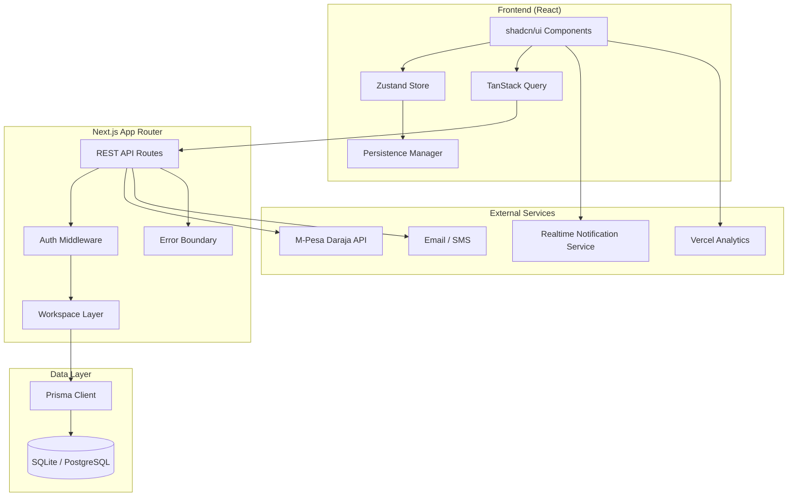

# Architecture

Mbumah Hardware POS is a single-page application served by a Next.js App Router backend. The frontend is a React client built with shadcn/ui components, Zustand for client state, and TanStack Query for server state. The backend exposes REST API routes that enforce authentication, role-based access control, and multi-tenant scoping before touching the database through Prisma ORM.

Production runs on Next.js 16 against PostgreSQL (Neon in production, SQLite locally and on offline installs). Since v2.16.0 the same app also serves per-branch subdomain workspaces on top of one shared database (see [Subdomain workspaces](subdomain-workspaces.md)).

## System diagram

## One page, one API

- **SPA shell**: the entire product UI renders from a single page (`src/app/page.tsx`) plus the workspace routes (`/stores/[slug]/[[...rest]]`, `/org/dashboard`, `/branches/select`, `/chat`). Tabs are lazily loaded client components, not routes - switching tabs never reloads the shell.
- **API routes**: everything under `/api/*` is a REST endpoint with a uniform envelope (`{ success, data }` / `{ success, error }`). They are the only server surface the SPA consumes; page routes exist for routing and metadata only.

## Tech stack

| Category | Technology | Version |
|----------|-----------|---------|
| Framework | [Next.js](https://nextjs.org/) (App Router) | 16 |
| Language | [TypeScript](https://www.typescriptlang.org/) | 5 |
| Styling | [Tailwind CSS](https://tailwindcss.com/) + [shadcn/ui](https://ui.shadcn.com/) | 4 |
| Database | [Prisma ORM](https://www.prisma.io/), SQLite (dev) or PostgreSQL (prod) | 6 |
| State management | [Zustand](https://zustand.docs.pmnd.rs/) (client) + [TanStack Query](https://tanstack.com/query) (server) | 5 |
| Forms | [React Hook Form](https://react-hook-form.com/) + [Zod](https://zod.dev/) | 7 / 4 |
| Authentication | [NextAuth.js](https://next-auth.js.org/) | 4 |
| Payments | [M-Pesa Daraja API](https://developer.safaricom.co.ke/) | n/a |
| Charts | [Recharts](https://recharts.org/) | 2 |
| Animations | [Framer Motion](https://motion.dev/) | 12 |
| Icons | [Lucide React](https://lucide.dev/) | n/a |
| Analytics | [Vercel Analytics](https://vercel.com/analytics) | 2 |
| Theming | [next-themes](https://github.com/pacocoursey/next-themes) | n/a |
| Tables | [TanStack Table](https://tanstack.com/table) | 8 |

## Core modules

| Module | Description |
|--------|-------------|
| Multi-branch POS | 5 stores: Juja Main, Thika, Ruiru, Nairobi CBD, Nakuru |
| Role-based access control | 7 roles (including the multi-branch WAREHOUSE_MANAGER) with a permission matrix enforced in the API and the UI (see [RBAC](rbac.md)) |
| Product and inventory | Categories, bundles, stock movements, low-stock alerts |
| Sales and POS | Fast checkout with M-Pesa integration via the Daraja API (STK Push) |
| Customer CRM | Debt management, loyalty points, aging buckets, statements |
| Equipment rentals | Rent-out tracking, return processing, overdue alerts |
| Gift cards | Full CRUD, reasons, auto-adjusting visibility, redemptions |
| Financial management | Double-entry bookkeeping, journal entries, chart of accounts |
| Shift management | Shift start and end with cash drawer reconciliation |
| Supplier management | Supplier profiles, purchase orders, fulfillment tracking |
| Expense tracking | Categorized expenses with approval workflows |
| Reports and analytics | Sales, inventory, and financial reports with CSV and PDF export |
| Tax compliance | eTIMS-ready invoice structures and KRA tax-type summaries |

Additional cross-cutting features: multi-tenant data isolation, an error boundary with a SUPER_ADMIN detail overlay, state persistence in localStorage, a 30-minute idle timeout with auto-lock, Vercel Analytics, and dark and light themes.

## Hardware-store-specific capabilities

These modules exist because hardware shops follow trade patterns that general retail systems do not model.

| Feature | Why it matters for hardware |
|---------|------------------------------|
| Equipment rentals | Hardware shops rent out generators, ladders, scaffolding, plate compactors, and breakers. The full rental lifecycle is supported: checkout, overdue alerts with daily-rate accrual, return with damage assessment, and security-deposit refund or forfeiture. The `Rental` model tracks `dailyRate`, `securityDeposit`, `damageFee`, and `status` (`ACTIVE` / `RETURNED` / `OVERDUE` / `LOST`). |
| B2B customer debt (mkopo) | Contractors and fundis (masons, plumbers, electricians) buy on credit and settle weekly or monthly. Aging buckets (30/60/90 days), per-contractor credit limits, statement exports, and a debt-collection dashboard are built in. The `Debt` model carries `dueDate`, `status` (`OUTSTANDING` / `PARTIALLY_PAID` / `SETTLED` / `WRITTEN_OFF`), and `agingBucket`, and the Accounts Receivable report rolls it up by contractor. |
| Bulk and bundle pricing | Cement by the bag, nails by the kg, paint by the drum, mesh by the metre. Unit-of-measure conversions and bundle SKUs (for example, a tiling kit of one trowel, one level, and five spacers) are native. |
| Supplier purchase orders | Track POs to local distributors (Bamburi Cement, Crown Paints, Rhinox Plumbing) with line-item fulfillment, backorder tracking, and landed-cost calculation so the unit cost reflects transport, not only the invoice price. |
| Shift cash reconciliation | Cash drawer counts at shift open and close, critical for shops running cash and M-Pesa on mixed tills. Discrepancies are flagged for the manager and logged to the audit trail. Both blind close (cashier declares a count without seeing the expected amount) and revealed close (manager mode) are supported. |
| Gift cards | Full CRUD with reasons, auto-hiding exhausted cards, and redemption history. Used for corporate buyers and holiday gifts. |
| KRA eTIMS-ready invoices | Every `Transaction` carries `taxBreakdown` (VAT 16% / Zero-Rated / Exempt) and a sequential invoice number, structured to map to KRA eTIMS fields. |

## Offline resilience

Hardware shops in peri-urban Kenya (Juja, Thika, Ruiru, Nakuru) regularly lose connectivity, so the POS is built to keep selling through interruptions:

- **Persisted cart and form state**: in-progress sales survive reloads and logout (cart snapshots in IndexedDB per store). On reload the cashier can resume or void the sale instead of re-entering it.
- **Queued M-Pesa STK requests**: STK requests are queued and the Daraja query API is polled on a backoff schedule. When the network returns, the queued request is confirmed and the sale is posted automatically.
- **Optimistic UI with rollback**: sales, debt payments, and rental checkouts render instantly and roll back only if the server rejects them.
- **30-minute idle timeout with auto-lock**: protects the till when a cashier steps away to load a customer's truck.
- **Idempotent monetary writes**: every monetary write accepts a client-supplied idempotency key, so a retried request after a network blip never double-posts.

## Request pipeline (src/proxy.ts)

The Edge proxy runs in front of every request. Page routes get the workspace pipeline (host allowlist, subdomain rewrite, workspace headers); API routes get the full security pipeline:

| Layer | Check | Failure |
|-------|-------|---------|
| Preflight | OPTIONS answered in the proxy with CORS for allowlisted origins only (exact origin echo, credentials allowed) | 204 without CORS headers for unknown origins |
| 1. Rate limiting | Tiered per IP + path: AUTH 5/15min, PASSWORD_RESET 3/h, PAYMENT 20/min, READ 100/min, WRITE 30/min, SEARCH 30/min, MESSAGING 30/min, CLIENT_ERROR 5/min | 429 + `Retry-After` |
| 2. Request size | Content-Length at most 1 MB | 413 |
| 3. CSRF | `X-CSRF-Token` header matching the `csrf_token` cookie, or exact Origin/Referer host equality (fail closed on unparseable values) | 403 |
| 4. Content-Type | State-changing requests must be `application/json` | 415 |
| 5. Authentication | Bearer presence on non-public paths | 401 |

Public paths (Bearer not required): `/api/auth/login`, `/api/auth/logout`, `/api/payments/mpesa/callback`, `/api/security/csrf-token`, `/api/logs/client-error`, `/api/openapi`, plus `/api/health*`. The proxy is a convenience layer - the DB-backed guards in `src/lib/auth.ts` are the real boundary (see [RBAC](rbac.md)).

## Tenant scoping

Every store-scoped Prisma model is filtered automatically by the tenancy extension in `src/lib/db.ts` (`STORE_SCOPED_MODELS`, 47 models): queries, unique lookups, nested writes and `createMany` data all get `storeId` injected from the tenant context. Routes establish the context through `requireStoreAccess` (primary store, or a validated `tenantOverride` when a multi-store member opens another branch); cross-store operations opt out explicitly with `runWithoutTenant` and carry their own role gates and filters. Details: [RBAC](rbac.md) and [Multi-tenant architecture](multi-tenant-architecture.md).

## Workspaces layer (v2.16.0)

One shared database; each branch is addressable as its own website:

- `src/lib/workspace/config.ts` - pure Edge-safe helpers: host parsing, allowlist matching, reserved subdomains, mode resolution (`auto` / `subdomain` / `path` / `off`).
- `src/proxy.ts` - rewrites `{sub}.{root}/x` to `/stores/{sub}/x` and attaches `x-store-subdomain` / `x-store-slug` headers.
- `src/lib/workspace/server.ts` - DB-backed store resolution and authorization (`resolveStoreContext`), with audit logging of denials.
- `src/lib/workspace/links.ts` + `session-cookie.ts` - link building per host mode and the shared `mbt_token` cookie for cross-subdomain single sign-on.
- Workspace surfaces: branch gateway, organization console, branch selector, global chat (`/chat`).

Full details: [Subdomain workspaces](subdomain-workspaces.md) and [Multi-store workspaces](multi-store-workspaces.md).

## Offline queue

When a checkout cannot reach the API, the sale is persisted to the IndexedDB database `mbumah-offline-pos` (store `transactions`) with a client receipt number (`OFFLINE-<ts>-<rand>`) and a stable `idempotencyKey`. On reconnect the queue replays FIFO with the original auth; the server deduplicates on the unique `idempotencyKey`, so a retried sale can never double-charge. The same database holds per-store cart snapshots (store `carts`, keyed by `storeId`) so branch workspaces never mix trolleys. The top-bar indicator surfaces queue state on every tab. Details: [Offline mode](offline-mode.md).

## Realtime notifications (socket.io mini-service)

Live receipt distribution and POS notifications ride a small dedicated socket.io service (`mini-services/notification-service`, internal port 3003), not the Next.js app. It serves `join-store` rooms so each branch receives only its own events. Self-hosted deployments run it as the internal-only `notification` container; nginx routes same-origin `/socket.io/` traffic to it with websocket upgrade headers and 24h timeouts. On Vercel the service does not run and the client degrades gracefully (status stays `disconnected`, everything else works). Chat deliberately uses REST polling instead of this socket (see [Global chat](global-chat.md)).

## Deployment topologies

The same build runs in every topology:

- **Vercel + Neon**: serverless; wildcard domain for subdomains; no realtime service (graceful degradation). See [Vercel deployment](vercel-deployment.md).
- **Docker Compose production** (`docker-compose.prod.yml`): PostgreSQL 15, the Next.js app (standalone build), the notification service, and nginx - all on an internal bridge network, with nginx as the only host-exposed service (80/443). See [Self-hosting](self-hosting.md).
- **Offline installs**: no Docker (`deploy/nodocker`) or laptop scripts, SQLite file database, optional mock M-Pesa. See [Local offline setup](local-offline-setup.md).

## Related documents

- [Subdomain workspaces](subdomain-workspaces.md)
- [Project structure](project-structure.md)
- [Multi-tenant architecture](multi-tenant-architecture.md)
- [Database schema](database-schema.md)
- [Configuration](configuration.md)
